# Everglade

**Package id:** `com.mardev.Everglade` · **Engine:** Godot 4.7.2 (Mobile renderer, GL Compatibility fallback) · **Platform:** Android (arm64-v8a + armeabi-v7a) · **Assets:** modelled in Blender by script

Everglade is a cosy, gridless diorama builder for phones and tablets: a stylised 3D miniature of
handcrafted medieval architecture under soft natural light, with tactile materials and organic
procedural detail (simple, readable large shapes; rich small detail). Towns borrow the fantasy
flavour of storybook European villages (stone ground floors under timber framing, tiled roofs,
lanterns, windmills and fountain plazas). It follows the gameplay of
*Tiny Glade* (Pounce Light, 2024): there are no goals, no currency and no grid. You doodle walls,
paths and cottages, and the glade works out the details: arches, doors, gates, bridges, ivy, sheep
and lanterns at dusk.

> Everglade is an original work inspired by Tiny Glade's mechanics and handcrafted-diorama look.
> It contains no code, art, audio, characters, logos or names from other games. Every model is generated by `blender/build_assets.py` and
> every sound by `tools/gen_audio.py`.

| Meadow Ruins | Town Plaza | Jade Lake Village |
|---|---|---|
| 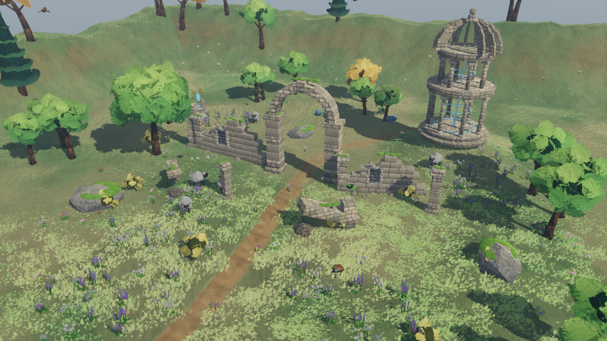 | 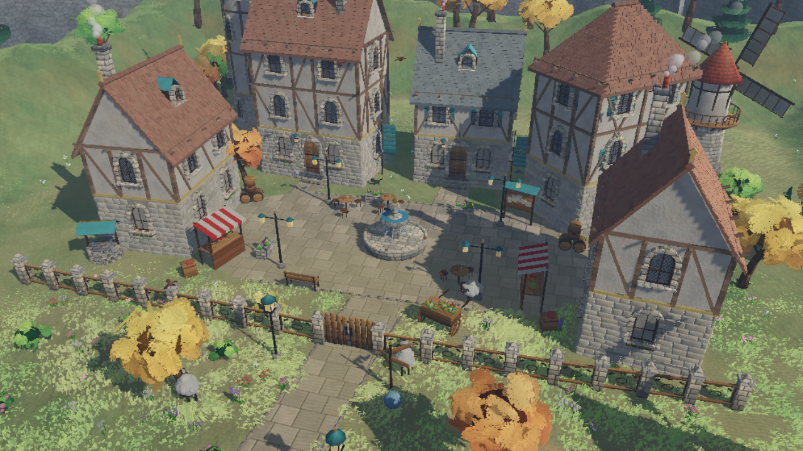 | 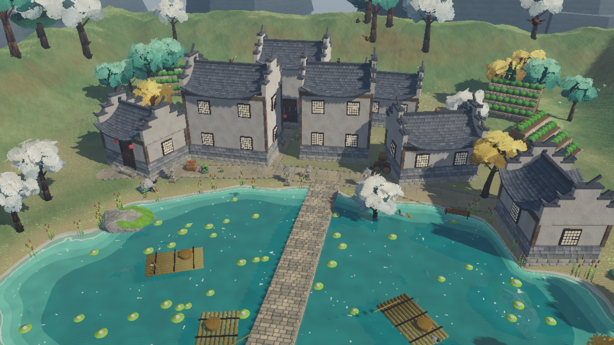 |
| 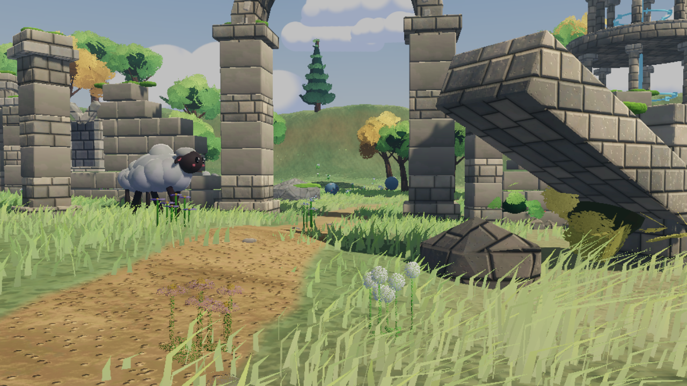 | 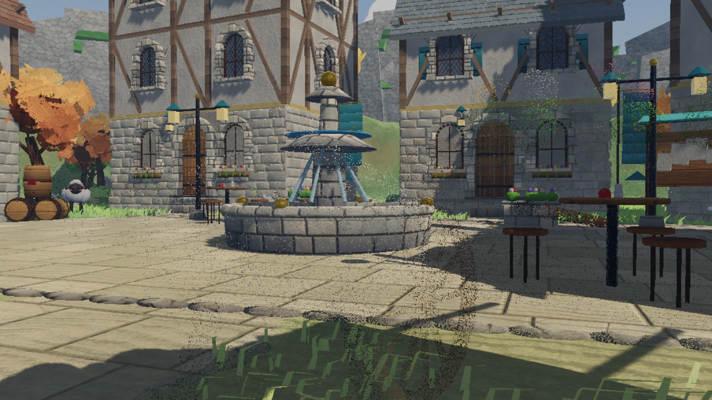 | 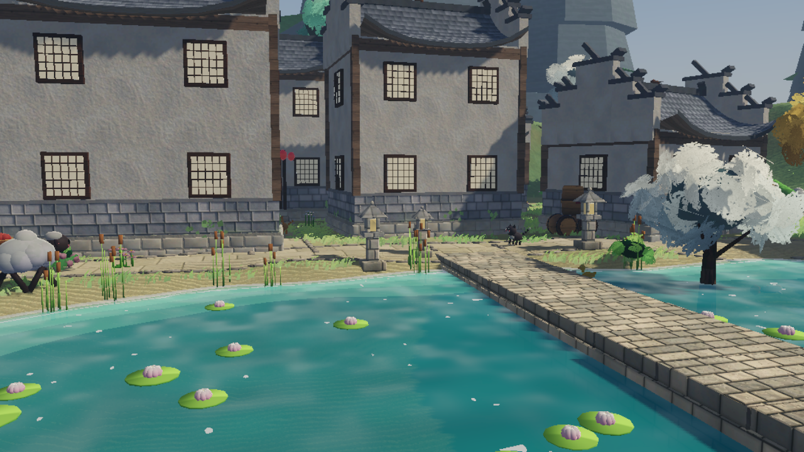 |

| Day | Night | Winter |
|---|---|---|
| 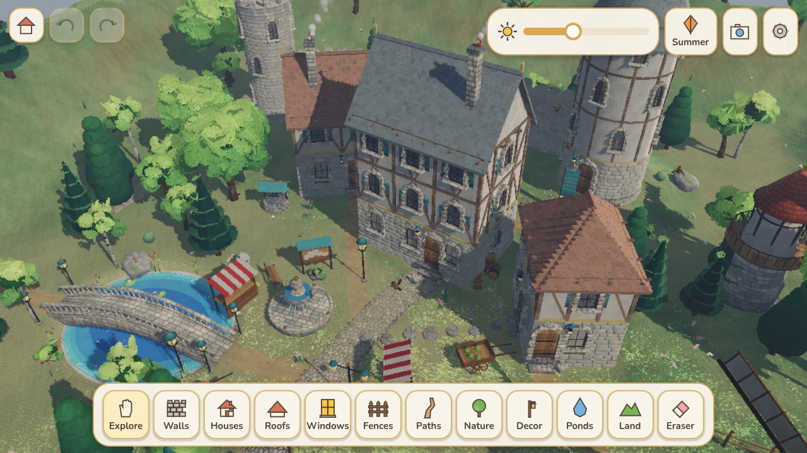 | 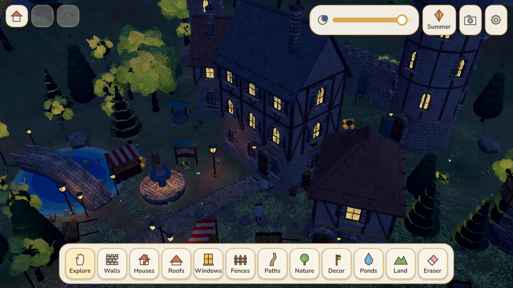 | 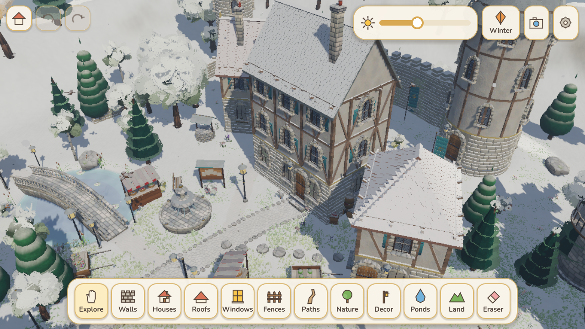 |
| 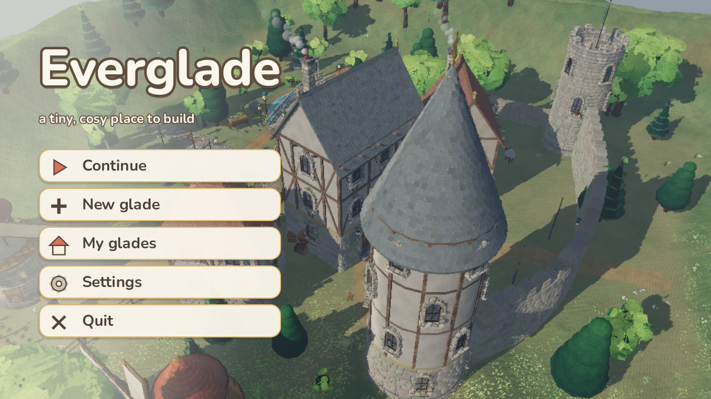 | 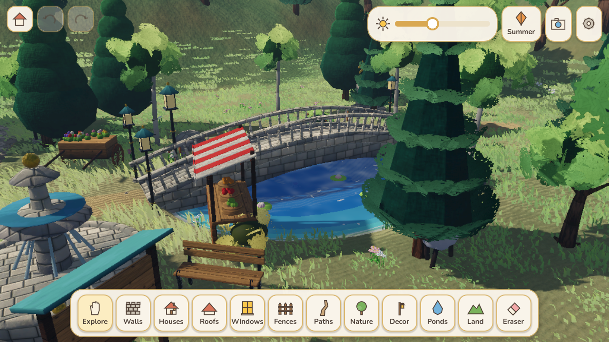 | 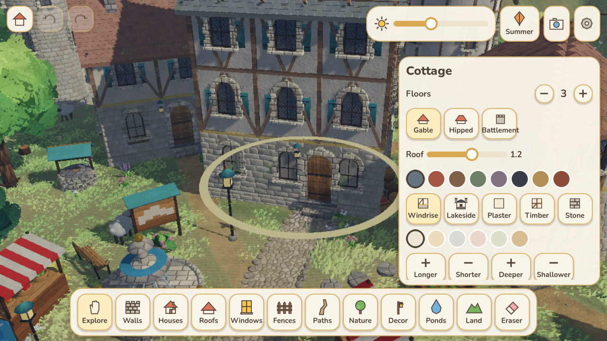 |

---

## 1. Research: how Tiny Glade plays

Sources: Steam community guides, Pounce Light dev posts, 80.lv interviews, and PC Gamer and
GamingOnLinux patch coverage.

| Tiny Glade mechanic | What it does | Everglade implementation |
|---|---|---|
| Freehand walls | Drag to draw; walls follow terrain; you can raise them very tall | `WallTool` + `WallView`: smoothed polyline, height slider 0.8–7 m, follows the ground |
| Battlements | Tall walls grow crenellations | Walls ≥ 3.2 m get merlons; flat roofs get parapets |
| Path → archway | Drawing a path through a wall carves an arch, widened by path width | `Glade._compute_interactions` finds crossings, and the wall mesh is cut into a semicircular arch with a soffit and lanterns |
| Low walls | Paths through low walls make gaps with posts | Gap with stone pillars and caps |
| Fences + gates | Wooden fences, with a gate where a path crosses | `FenceView` posts/rails; gate model spans the crossing |
| Buildings | Drag out a footprint and the building rises | `BuildingTool`: drag sets length and orientation, with a rise-from-ground animation |
| Towers | Round buildings become towers | Tower mode: cone roof with a weathervane, or battlements with a banner |
| Floors / height | Drag to make buildings taller | Inspector floor stepper (1–6) |
| Roof shapes & colours | Gable, hip, flat; steepness; palette | `RoofTool` and inspector: gable/hip/battlement/spire, pitch slider, 8 colours |
| Windows tool | Click walls for windows; at floor level they become doors; on roofs, dormers | `DetailsTool`: tap a wall for a window, tap low for a door, tap the roof for a dormer, tap again to remove |
| Doors from paths | A path reaching a house makes a door | Automatic door, step and wall lantern where a path meets a wall |
| Chimneys | Chimneys on roofs, smoking | Chimney mode, plus smoke particles |
| Timber framing, styles | Varied facades | Plaster (with quoins), timber frame (beams + braces), stone |
| Ivy | Ivy creeps over walls over time | Ivy grows over ~15 min and is saved per wall/building (toggle in the inspector) |
| Paths & stepping stones | Dirt/cobble paths; stepping stones over water | Dirt, cobble (Voronoi stones + border cobbles), paved flagstones with kerbs, and stepping-stone styles |
| Bridges | A path over water becomes a bridge | Arched wooden bridge along each water crossing |
| Stairs on slopes | Steps appear on steep paths | Stone steps on slopes > 0.55 |
| Terrain | Raise/lower land, hills | `TerrainTool`: raise, lower, smooth, flatten (hold to sculpt) |
| Ponds | Dig and water fills it | `WaterTool`: dig or fill; depth-tinted water, foamy shores, reeds along banks and lily pads |
| Forest & flower brushes | Paint trees, bushes, flowers | `NatureTool`: forest, leafy, great oak, golden, blossom, firs, bushes, flowers, lavender, rocks, with a brush size |
| Decorations | Lanterns, wells, carts, haystacks… | `DecorTool`: 32 props with 3D thumbnails (windmills, fountains, stalls, café tables, ruins, rotunda, stone lanterns, tea terraces, bamboo rafts that float…); drag to rotate while placing |
| Eraser | Rub out things; walls are split | `EraserTool`: cuts walls/fences/paths, removes props and buildings |
| Sheep (pettable), ducks, birds | Wildlife appears based on what you build | Sheep flock, duck families on ponds, chickens near houses, birds perching on walls and roofs, butterflies; tap any of them for a heart |
| Day/night | Drag the sun; lanterns and windows glow at night | Time-of-day slider, warm golden hour, moonlight, glowing windows and lanterns, fireflies |
| Seasons | Summer/autumn/winter looks | Spring (petals), summer, autumn (orange leaves; evergreens stay green), winter (snow on every upward surface, frozen ponds, snowfall) |
| Photo mode | Hide UI, frame shots | Tilt-shift depth of field, free orbit/tilt, shutter saves to *Pictures/Everglade* |
| Undo/redo, many glades | | 40-step undo/redo, autosave, glade gallery with thumbnails, 7 starting templates |
| Soft piano/strings soundtrack | Sparse, calm music | Three generated pieces (plucked harp over pads) with long gaps; day birdsong and night crickets |

## 1b. Art direction: a handcrafted miniature

| Element | Implementation |
|---|---|
| Stonework | `scripts/build/masonry.gd`: walls, towers, foundations and stone storeys are faced with **individually modelled stones**: bevelled, slightly pillowed blocks laid in courses over a recessed mortar core. Course heights, stone lengths, protrusion, tilt and colour vary within believable limits; stones are clipped to the wall's real outline (terrain, tops, path openings) and trimmed against windows and doors, so the facing follows the structure. Arches get radial **voussoirs with a keystone** and dressed jamb stones, wall tops get **coping stones**, wall ends get alternating **quoins**, battlements are bevelled merlons |
| Roofs | `scripts/build/roofing.gd`: **individual overlapping tiles** in staggered courses on gable, hipped and conical roofs; each lower lip is lifted so every course casts a fine shadow line, with tonal variation and the odd weathered or mossy tile |
| Windows & doors | Deep-set windows in a 20 cm surround of separate stones (jambs, voussoirs, keystone, projecting sill), a timber casement set back in a shadowed reveal, leaded panes; glass reads as a dark interior by day and glows at night. Doors are individual planks of varied tone under a voussoir arch, with iron straps and a worn threshold |
| Lighting | `shaders/toon.gdshaderinc`: soft wrapped sunlight with gentle terminators and soft shadow edges, a restrained roughness-driven highlight (matte stone, a small glint on iron); cool sky fill keeps shade readable; filmic tone mapping; warm golden hour, blue night |
| Contact shadows | `shaders/contact_ao.gdshader`: full-screen depth-based contact shading. Opposite sample pairs at two radii detect concave creases only (flat and sloped surfaces cancel), so stone joints, wall bases, eaves, window reveals and grass roots darken softly without halos |
| Fog | Exponential height fog that thins over the glade and thickens with distance and near the ground; **Fog** and **Fog height** sliders in Settings |
| Night | `scripts/world/night_lights.gd`: a pool of warm, flickering point lights follows the lanterns nearest the camera, lighting nearby walls and paths; glowing windows; fireflies |
| Palette | Restrained and natural: limestone, sandstone and weathered grey stone, warm off-white limewash, honey-brown wood, slate, terracotta and muted red roofs, soft meadow greens; colour contrast reserved for small details |
| Sky | `shaders/sky.gdshader`: soft gradient sky, sun halo, stars; painted cumulus billboards |
| Buildings | **Windrise** style: stone ground floor with quoins and gold trim, white plaster and timber braces above, carved eave brackets, steep gable/hip roofs with gold ridge finials, spire towers with golden wing finials |
| Windows & doors | Arched stained-glass windows with teal shutters and flower boxes; arched double doors under stone arches with gold handles and iron lamps |
| Bridges | Stone arch bridges with balustrades and ornate lamp posts at both ends |
| Props | Windmills (sails turn with the wind), tiered fountains, market stalls, flower carts, wind shrine with a floating crystal, iron street and plaza lamps, banners, signposts, notice boards, wine barrels, apple crates |
| Nature | Painted top-lit canopies, a great oak, firs, birches, fruit bushes, cecilia, pinwheel and dandelion flowers |
| Creatures | Bouncy slimes, glowing crystalflies at dusk, sheep, cats, ducks, chickens, sparrows, fish, butterflies, all with big glossy eyes |
| Surface materials | 16 tileable materials made by `tools/gen_materials.py` (cut stone, rough rock, wood planks, bark, plaster, roof tiles, woven cloth, hammered metal, moss, cobbles, straw, meadow, dirt, flagstones, sand), each with detail albedo, normal map and roughness, packed in two texture arrays. Every Blender part carries its material id, so props get triplanar textures with normal-mapped relief; buildings and terrain use the same set |
| Modelling detail | Every hard edge of every prop is bevelled (2 segments) so blocks, beams and posts catch highlights |
| Lighting | Soft three-step cel bands, crisp shadow edges, roughness-driven highlights (sharp on metal and gold, broad on stone), rim light |
| Painted foliage | Trees are built from hundreds of alpha-cut leaf cards (`tools/gen_textures.py` paints the leaf-cluster atlas) with spherical canopy normals, lit in three soft cel bands: bright sunlit crowns, deep cool undersides |
| Meadow grass | A dense carpet of thin curved blades (`shaders/grass.gdshader`, procedural blade patches instanced per terrain chunk). Every blade takes its colour from the painted ground under its root, so the carpet melts into the terrain; dark roots, fresh green tips, rolling wind gusts that sweep across the meadow, sunlight glowing through the tips, a soft sheen, blades that thin up close and widen far away, mown short around houses and paths and shaggy in the wild golden drifts, and sheep, cats, chickens and slimes part the grass as they walk. Lavender and wildflower brushes on top |
| Clouds | Hand-painted cumulus billboards (`clouds.png` atlas) in a low horizon bank and high puffs, tinted by the time of day |
| Backdrops | Per-template scenery in the depth haze: karst peaks around the jade lake, grey cliffs behind the town, big trees on the surrounding hills |
| Showcase glades | **Meadow Ruins** (carved arch, broken walls with pointed niches, pillars, fallen slabs, a broken-dome rotunda with glowing rings), **Town Plaza** (paved square, fountain, café tables, planters, stalls, ornate stone-pillar fence and gate, red-roofed timber houses with dormers, windmills with balconies and canvas sails, golden trees), **Jade Lake Village** (whitewashed houses with curved dark roofs and stepped horse-head gables, lattice windows, lantern doors, a flagstone causeway, bamboo rafts, tea terraces, blossom and ginkgo trees) |
| Building styles | Windrise (timber and stone), **Lakeside** (white walls, stone skirting, upturned eaves, stepped gables), plaster, timber, stone |
| Paths & fences | Dirt, cobbles, **paved flagstones** (become stone causeways with stone lanterns over water), stepping stones; rustic or **ornate** fences |
| Music | Lyre and flute pieces in lydian, major and dorian modes; wind gusts and birdsong; crickets and frogs at night |

## 2. Controls

**Touch (Android)**

- **One finger on a build tool:** draw, paint or place. A tap places single items.
- **One finger in Explore:** tap to select and edit, tap animals to pet them, drag the selected piece to move it, drag elsewhere to pan.
- **Two fingers:** pan, pinch to zoom (zooming in lowers the camera toward eye level), twist to rotate.
- **Back button:** deselect → back to Explore → main menu.

**Desktop (for testing)**

- Right-drag rotates and tilts, middle-drag pans, the wheel zooms, WASD/QE moves.
- `1`–`9` pick tools, `Ctrl+Z` / `Ctrl+Y` undo/redo, `P` toggles photo mode, `Del` deletes, `Esc` goes back.

## 3. Project layout

```
everglade/
├── project.godot            Godot 4.7 config (Mobile renderer, shader globals, autoloads)
├── export_presets.cfg       Android preset: com.mardev.Everglade, icons, immersive, vibrate
├── scenes/game.tscn         single root scene (everything else is built in code)
├── scripts/
│   ├── game.gd              modes (menu/build/photo), input gestures, inspector, autosave
│   ├── core/                Settings, ModelLib, Sfx, GladeStore autoloads; MeshBuilder, Geo, Catalog
│   ├── world/               Terrain, Water, Grass, DayCycle, CameraRig, Glade (rules + undo), templates
│   ├── build/               WallView, FenceView, PathView, BuildingView, PropBatch, Ivy, DecoMerge
│   ├── tools/               Hand, Wall, Building, Roof, Details, Fence, Path, Nature, Decor, Water, Terrain, Eraser
│   ├── life/                Sheep, Duck, Chicken, Bird, Butterfly, Life spawner
│   └── ui/                  HUD, main menu, settings, photo UI, vector icons, 3D thumbnails, theme
├── shaders/                 architecture (procedural stone/plaster/timber/tiles + moss + snow),
│                            terrain (paths, cobbles, sand, snow), water, props (wind, seasons), glow
├── assets/models/*.glb      103 props generated by Blender
├── assets/textures/         painted leaf, cloud and grass atlases (tools/gen_textures.py)
├── assets/audio/*.ogg       29 generated sounds/music loops
├── assets/icons/            launcher icons rendered in Blender (Cycles)
├── assets/fonts/            Nunito (SIL OFL)
├── blender/build_assets.py  Blender script: models every prop + renders the icons
├── tools/gen_audio.py       synthesises all SFX, ambience and music
├── tools/gen_textures.py    paints the leaf-cluster, cloud and grass textures
├── tools/gen_materials.py   generates the 16 surface materials (albedo/normal/roughness arrays)
├── tools/apksigner/         tiny apksigner stand-in (only for environments without the Android SDK)
├── tests/tour.gd            automated screenshot tour + 20 input-driven tool tests
└── tests/showcase.gd        renders the three reference showcase glades
```

## 4. Building

### Regenerate assets (optional; outputs are committed)

```bash
pip install bpy==5.2.2                 # Blender as a Python module (or use: blender -b -P …)
python blender/build_assets.py assets/models
pip install numpy soundfile
python tools/gen_audio.py assets/audio
pip install pillow
python tools/gen_textures.py assets/textures
python tools/gen_materials.py assets/textures
```

### Android APK (local)

1. Install **Godot 4.7.2** and its **export templates**, a JDK 17+, and the Android SDK (build-tools + platform-tools).
2. In *Editor Settings → Export → Android*, set the SDK path, Java path and debug keystore.
3. Run:
   ```bash
   godot --headless --path everglade --import
   godot --headless --path everglade --export-debug "Android" build/Everglade-debug.apk
   ```
   For a Play Store build, set `GODOT_ANDROID_KEYSTORE_RELEASE_PATH/_USER/_PASSWORD` and use `--export-release`.

### Android APK (CI)

`.github/workflows/everglade-android.yml` builds a debug APK on every push that touches
`everglade/`. Download it from the run's *Artifacts*. To also get a signed release APK, add the
repository secrets `ANDROID_KEYSTORE_BASE64`, `ANDROID_KEYSTORE_ALIAS` and `ANDROID_KEYSTORE_PASSWORD`.

### Tests

```bash
xvfb-run godot --path everglade --rendering-method mobile -- --tour=/tmp/shots
```

This prints `PASS`/`FAIL` for the input-driven tool tests and saves screenshots of the menu, the
hamlet in all seasons and times of day, the tools and photo mode. `-- --showcase=/tmp/show` renders the
three showcase glades from above and at eye level.

## 5. Performance notes (mobile)

- Props are drawn through one MultiMesh per kind; each wall, building, fence and path is merged into 2–3 meshes.
- Terrain is 64 chunks, and only edited chunks are rebuilt (a few per frame). Grass is one MultiMesh of blade patches per chunk (1.2 / 2.2 / 3.4 patches per m² by quality, 36 blades each, 3 triangles per blade); blades sink into the ground beyond ~30 m where the matching terrain colour takes over.
- Graphics presets *Battery / Balanced / Beautiful* change render scale (0.7/0.85/1.0), MSAA, shadows, grass density and depth of field.
- Water and terrain shaders don't use screen or depth textures, so they work on the GL Compatibility renderer.
